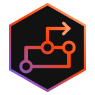

<p align="center">
  
</p>

<h1 align="center">Zenlev</h1>

<p align="center">TypeScript database migrations for ZenStack V3 and Kysely.</p>

<p align="center">
  <a href="https://www.npmjs.com/package/@mwillbanks/zenstack-zenlev"></a>
  <a href="https://github.com/mwillbanks/zenstack-zenlev/actions/workflows/ci.yml?query=branch%3Amain"></a>
  <a href="https://github.com/mwillbanks/zenstack-zenlev/pulls?q=is%3Apr+is%3Aopen+label%3Adependencies"></a>
  <a href="https://app.codecov.io/gh/mwillbanks/zenstack-zenlev"></a>
</p>

Zenlev runs schema and data migrations as a dependency graph. It serves teams whose database changes span deployment stages, application versions, or independent branches.

Declare prerequisites explicitly. Select pre-deploy, deploy, and post-deploy work through namespaces while preserving dependencies between stages. Review plans before execution, retain executed hashes for audit, and generate reviewable cascade or compensation migrations when recovery requires reversal.

Use your existing ZenStack V3 client or a standalone Kysely adapter with SQLite, PostgreSQL, or MySQL. Zenlev uses Bun to run TypeScript migrations. Continue to use `zen db pull` for introspection.

## Quick start

Use Bun 1.4.4 or later and Kysely 0.29. ZenStack projects also need a compatible `@zenstackhq/orm` 3.x release.

```sh
bun add -d @mwillbanks/zenstack-zenlev
```

Create `zenlev.config.ts` beside your project manifest. Import your configured client.

```ts
import { defineConfig } from '@mwillbanks/zenstack-zenlev'
import { db } from './db'

export default defineConfig({ client: db })
```

Generate a migration. Add changes to its `up` handler and provide `down` when reversal is safe.

```sh
bun run zenlev migrate create --name add_accounts --empty
bun run zenlev migrate apply --plan-only
bun run zenlev migrate apply
```

Both `zenlev` and `zenstack-zenlev` run the same CLI. Add `--json` for automation.

Follow the [setup guide](https://mwillbanks.github.io/zenstack-zenlev/docs/guides/quick-start) and [dialect examples](https://mwillbanks.github.io/zenstack-zenlev/docs/dialects) for complete connection configuration.

## Agent skills

The npm package ships five task-focused Agent Skills for setup, migration authoring, deployment planning, schema diffing, and recovery. TanStack Intent discovers guidance from the installed package version.

Use an explicit skill allowlist and exclusions. Load the guidance needed for each task. The [Agent skills guide](https://mwillbanks.github.io/zenstack-zenlev/docs/guides/agent-skills) includes pinned npm and Bun commands, configuration, and the static discovery trust model.

## Plan changes across deployments

Namespaces organize deployment stages. Dependencies remain global, so selecting a deploy namespace reports any pending pre-deploy prerequisite as a blocker. Tags and explicit IDs refine the selected scope.

Superseding migrations replace graph history explicitly. Rollback generates a new migration for review. Baselines preserve the schema needed by future environments without replaying every historical migration.

Read [deployment planning](https://mwillbanks.github.io/zenstack-zenlev/docs/guides/deployments) and [recovery](https://mwillbanks.github.io/zenstack-zenlev/docs/guides/rollback-recovery) before operating a staged rollout.

## Schema changes and Prisma adoption

Preview current ZModel changes with `bun run zenlev db push --sql`. Review SQL and manual migration diagnostics before execution. Decide explicitly whether missing live tables should be dropped.

For existing Prisma projects, verify the current schema, retire the old migration job, and preserve its ledger. Start a separate Zenlev history for future changes. Follow the [adoption guide](https://mwillbanks.github.io/zenstack-zenlev/docs/guides/adoption) for adoption and clean database bootstrap.

## Documentation and contributing

- [Documentation](https://mwillbanks.github.io/zenstack-zenlev/docs)
- [CLI reference](https://mwillbanks.github.io/zenstack-zenlev/docs/reference/commands)
- [API reference](https://mwillbanks.github.io/zenstack-zenlev/docs/reference/api)
- [Changelog](https://github.com/mwillbanks/zenstack-zenlev/blob/main/CHANGELOG.md)
- [Contributing](https://github.com/mwillbanks/zenstack-zenlev/blob/main/CONTRIBUTING.md)
- [Security](https://github.com/mwillbanks/zenstack-zenlev/blob/main/SECURITY.md)

Released under the [MIT license](https://github.com/mwillbanks/zenstack-zenlev/blob/main/LICENSE).
